# 📊 UIII Act3: Importación y Descripción de Datos
## Emily Barraza NC = 0025
> **🎓 Asignatura:** Soluciona problemas de Machine Learning  
> **📚 Nivel:** Tercer semestre de preparatoria  
> **🤖 Especialidad:** Inteligencia Artificial  
> **📈 Dificultad:** Cero a principiante  
> **🐍 Lenguaje:** Python  
> **🛠️ Herramientas:** Visual Studio Code, Pandas, Matplotlib y CSV  

## Servidores de empresa

## Tabla original
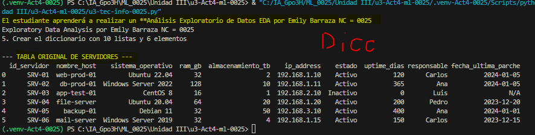

## convertir el diccionario en DataFrame
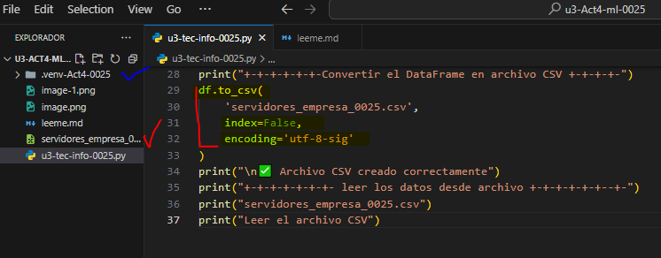

## Datos de cvs
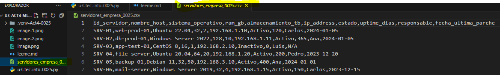

## Análisis exploratorio de DataFrame (EDA)
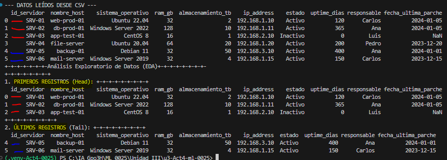

## Dimenciones y estructura
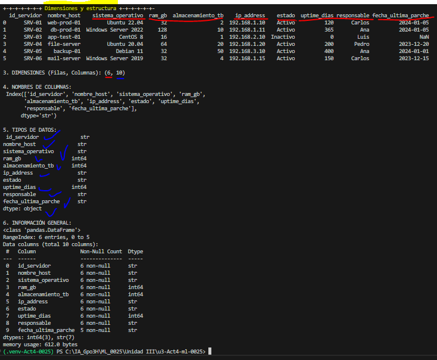

## Estadisticas y limpieza
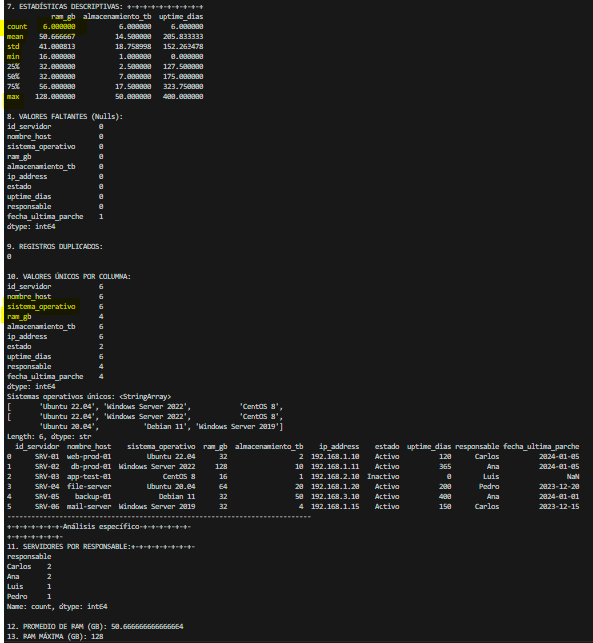

## Ordenando, filtrando y agrupación
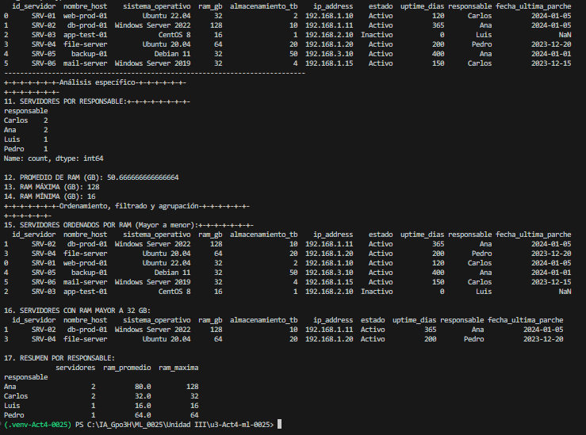

## Grafica de barras: Servidores de empresa
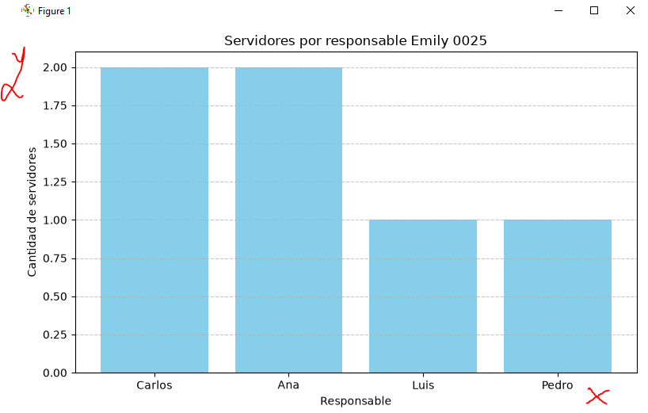

## Grafica de barras: Memoria RAM
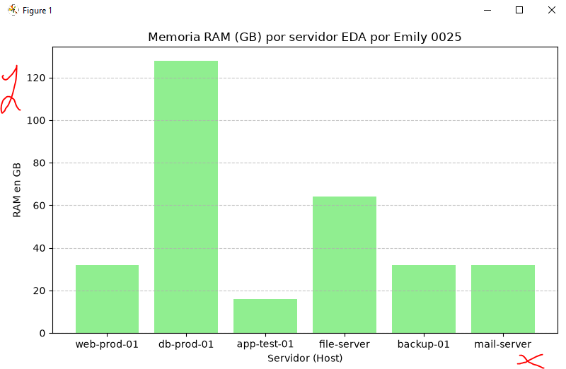

## Grafica de barras: Distribucion de almacenamiento
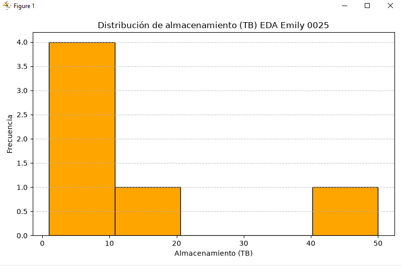

## Grafica de distribucion
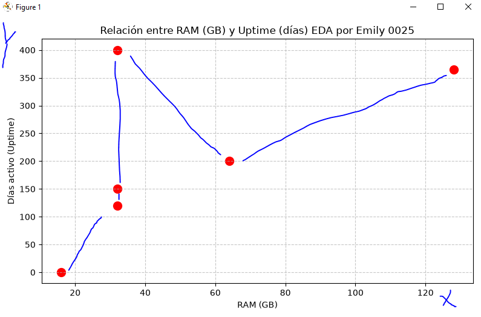

## Diagrama de caja
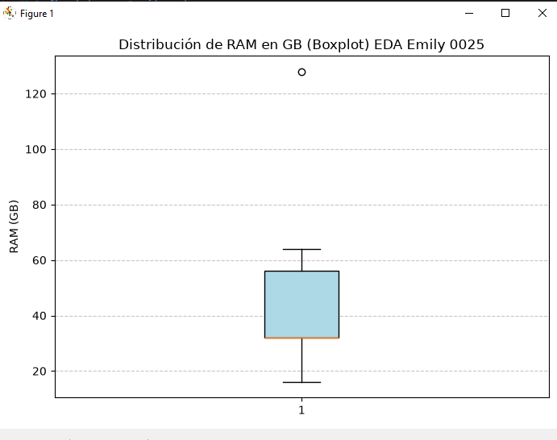

## Matriz de correlación
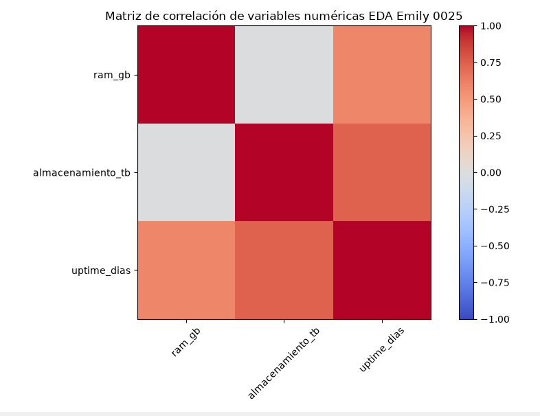